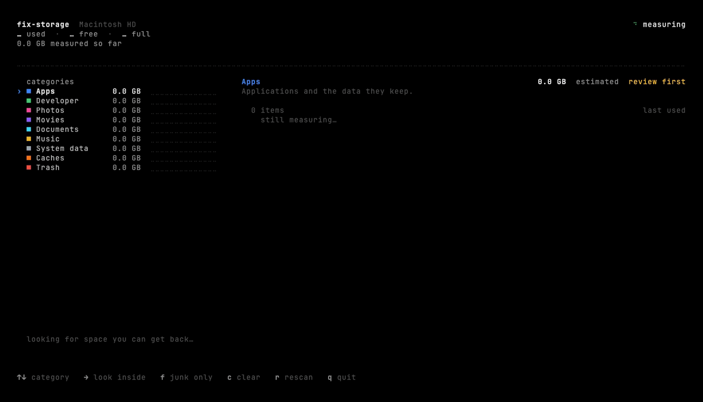
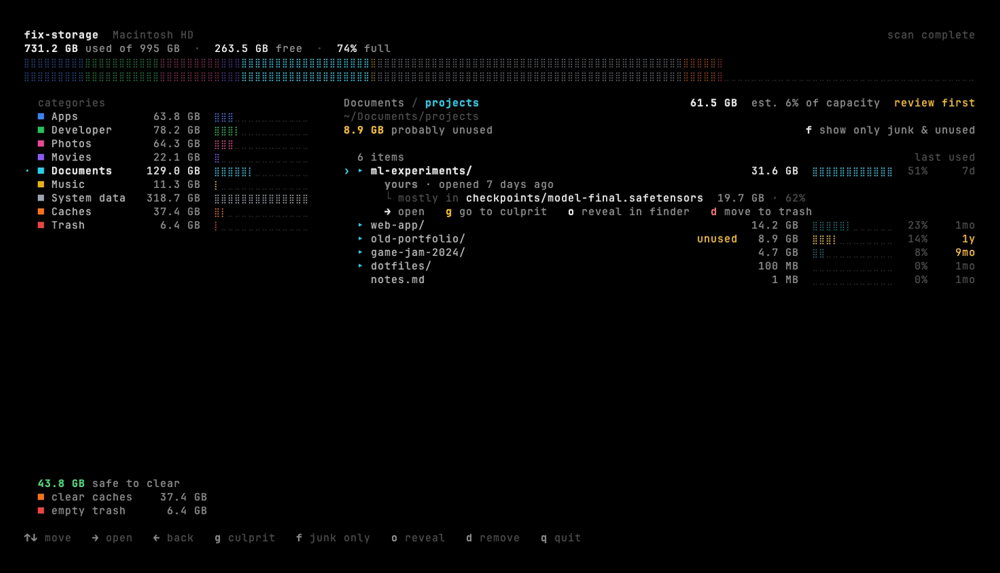
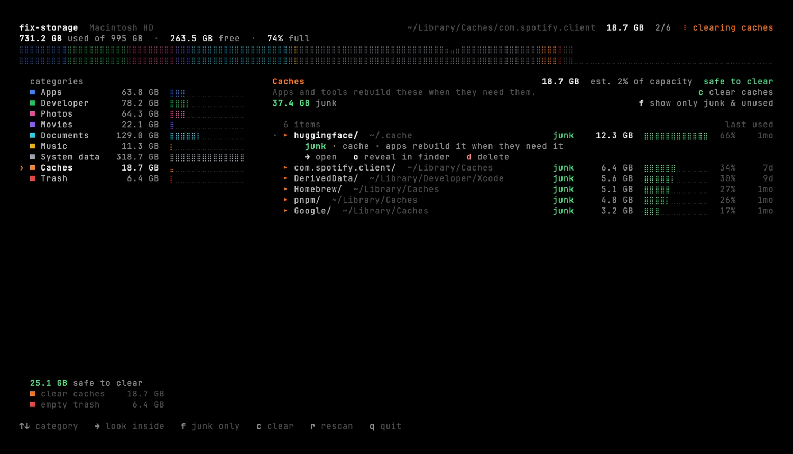

# fix-storage

See what is filling your Mac's disk, find the culprit, and clear what is safe to clear, from the terminal.



## Run it

```sh
bunx @wyattjoh/fix-storage
```

No installer script, no global install, no background downloads. It needs:

- macOS
- [Bun](https://bun.sh) 1.2 or newer
- [dust](https://github.com/bootandy/dust), which measures the folders: `brew install dust` or `mise use -g dust`

A full scan takes a minute or two on a well-used disk. Everything you open after that comes from the scan, so browsing is instant.

## What it shows

- The disk as a bar, one colored segment per category: Apps, Developer, Photos, Movies, Documents, Music, System data, Caches and Trash. It grows as the scan measures and shrinks as you clear.
- Each category's biggest folders and files, labelled `junk` (rebuilds itself or is a leftover), `unused` (probably not needed any more) or `system` (a tool or macOS owns it), with when each was last opened.
- For a big folder, where its space actually is ("mostly in a/b/model.bin, 31 GB · 77%"), and a key that walks straight there.

| Browse into a folder and see where its space is                                         | Clear caches with two presses                                                     |
| --------------------------------------------------------------------------------------- | --------------------------------------------------------------------------------- |
|  |  |

## Keys

| Key               | Does                                          |
| ----------------- | --------------------------------------------- |
| `↑` `↓` / `j` `k` | move                                          |
| `→` / `enter`     | look inside a category, open a folder         |
| `←` / `esc`       | back                                          |
| `tab`             | switch between categories and the list        |
| `g`               | go to the highlighted folder's culprit        |
| `o` / `space`     | reveal in Finder                              |
| `d` / `⌫`         | remove the highlighted item (press twice)     |
| `c`               | clear Caches or empty the Trash (press twice) |
| `f`               | show only junk and unused                     |
| `r`               | rescan                                        |
| `q`               | quit                                          |

## What it will delete

- **Caches** and the **Trash** can be cleared as a whole, after a second press. Their contents are deleted for good: caches rebuild themselves, and the Trash is already thrown away.
- Anything else is removed one item at a time, after a second press, and goes to the **Trash**, where Finder can put it back.
- System data, macOS folders, folders your account needs (`~/Library`, Keychains, Mail, Messages and so on) and anything outside the folders it scans are never removed.

## Scripts

```sh
bunx @wyattjoh/fix-storage --plain   # text summary, deletes nothing
bunx @wyattjoh/fix-storage --json    # the same as JSON
```

Without a terminal (piped output), it prints the text summary.

## Full Disk Access

macOS hides some folders (Mail, Messages, the Trash itself) from apps without Full Disk Access. They show as unreadable and count toward System data. Give your terminal Full Disk Access in System Settings › Privacy & Security to include them.

## Development

```sh
bun install
bun run dev       # the real app, on your disk
bun run demo      # the same UI over a made-up disk; reads and deletes nothing
just check        # format, lint, typecheck, tests
just record       # re-record the GIF and stills in docs/ (needs vhs, ttyd, ffmpeg)
```

There is no build step: the TypeScript in `src/` is what gets published, and Bun runs it directly.

## Credit and license

MIT, see [LICENSE](LICENSE). A macOS-only port of [govijr/fix-storage](https://github.com/govijr/fix-storage) (MIT). The scan, classification and safety rules come from it. The graphical renderer (a hidden Electron that draws into the terminal) is replaced with [OpenTUI](https://github.com/anomalyco/opentui), so it runs straight from `bunx`.
